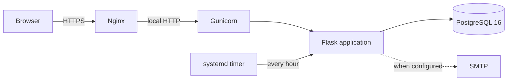

[Français](README.md) | **English** | [中文](README.zh-CN.md)

<p align="center">
  
</p>

<h1 align="center">Joinly</h1>

<p align="center">
  <strong>Find an activity, book a seat, meet there.</strong>
</p>

<p align="center">
  
  
  
</p>

<p align="center">
  <a href="https://isep.wangjiahan.com"><strong>Live demo — https://isep.wangjiahan.com</strong></a>
</p>

Student project of the **G1D Lab** group at **ISEP** (École d’ingénieurs du numérique). Joinly is a web application for discovering and booking activities, in the same family as a platform built around shared interests. Flask renders the pages; PostgreSQL 16 stores the data.

The repository has no `LICENSE` file. See [Team, credits and licence](#team-credits-and-licence).

## Contents

- [Overview](#overview)
- [Features](#features)
- [Screenshots](#screenshots)
- [Technology stack](#technology-stack)
- [Architecture](#architecture)
- [Repository layout](#repository-layout)
- [Local setup](#local-setup)
- [Environment variables](#environment-variables)
- [Tests](#tests)
- [Deployment](#deployment)
- [Security](#security)
- [Team, credits and licence](#team-credits-and-licence)
- [Further reading](#further-reading)

## Overview

Announcing an outing, a workshop or a sports session usually splits the notice, the sign-up list and the door check across different tools. A participant has to compare dates, places and remaining seats by hand. An organizer has to know who is coming and check them in without exposing e-mail addresses.

Joinly keeps those steps in one application:

1. browse published activities and open a page (description, Paris time, place, price, seats, and a map when coordinates are stored);
2. create an account, confirm the address, and choose at least three interests;
3. review a recap, then book — for free, or after a **simulated** payment confirmation;
4. receive an HTML e-mail with a QR code and a ticket link that works without signing in;
5. as an organizer, publish the activity, follow how full it is, and scan tickets;
6. as an administrator, moderate accounts, content and reviews.

The shipped interface is in French. Payment does not collect money: an activity priced above zero only asks for the “Simulated payment — student project” acknowledgement. No card number is collected.

`joinly_front/` keeps the original static mock-up. The running application is `app/`. Opening `index.html` starts neither Flask nor the database.

## Features

Roles are `member`, `organizer` and `admin`. They can be combined. Public sign-up offers member or organizer; nobody can grant themselves the administrator role. A member can also submit a request, which an administrator approves or refuses.

### Participant

- **Catalogue.** Home page and `/activities`, filtered by keyword, place, city, category, dates and price, sorted (date, popularity, price, rating) and paginated in the URL. Finished activities leave the default lists; they stay available by direct link and in the participant’s history.
- **Activity page.** Description, start and end in Europe/Paris, place, organizer, price or “Free”, remaining seats, cover photo (organizer upload or a category image, with credit). When latitude and longitude are stored, a Leaflet map uses OpenStreetMap France tiles.
- **Recommendations and ranking.** At least three interests are required (administrators are exempt). The home page shows “Recommended for you”. `/classement` ranks upcoming published activities.
- **Favourites and follows.** Save an activity, follow an organizer, and open the organizer’s public page.
- **Reviews.** After the activity ends, a participant whose booking is still confirmed leaves a rating from 1 to 5 and a comment, which can be edited. A review hidden by an administrator drops out of the average.
- **Two-step booking.** The button opens a recap (date, place, organizer, price, seats, cancellation policy, participant identity). The seat is created only after the “I have checked this information” box. A paid activity also requires the simulated-payment confirmation.
- **Cancellation.** Before the start, according to the activity’s policy: flexible (full refund until 24 hours before, otherwise none), moderate (full until 72 hours, otherwise half), strict (none). The amount is a simulated refund. The seat is freed and the ticket is invalidated.
- **Ticket and e-mail.** Each confirmed booking receives a short code `JOIN-XXXX-XX` and an unguessable token. The confirmation e-mail is HTML, with the QR code inline and a link to `/billets/<token>`. That ticket page **does not require a session**.
- **Reminder.** `send-reminders` notifies each confirmed booking once, in the app and by e-mail, when the activity starts within 24 hours. The systemd timer that runs it is hourly; `scripts/install-service.sh` does not install it.
- **Account.** Profile, avatar (JPEG, PNG or WebP, cropped to a square; initials otherwise), e-mail and password change, history, notification bell.
- **Access.** Sign-up, six-digit confirmation code, sign-in, sign-out. Google sign-in when both OAuth variables are set; otherwise the button is absent. Forgotten password by a single-use SMTP link, valid for 30 minutes, when mail is configured.
- **Public pages.** Contact, FAQ, terms of use, legal notice, privacy policy, “necessary cookies” banner (session cookie only), link sharing and a downloadable PNG poster.

### Organizer

- **Publishing.** Create and edit an activity as a draft or as published: title, description, place, city, coordinates, dates, capacity, price, cancellation policy, cover image. The organizer can no longer change the dates of an activity that has already finished.
- **Cancelling an activity.** Confirmed bookings are cancelled with a full simulated refund.
- **Participants.** List of confirmed attendees (display name, booking time, check-in state). E-mail addresses are not shown.
- **QR check-in.** “Ticket check” page: type the code or scan with the camera (`BarcodeDetector`, otherwise html5-qrcode). A ticket is accepted only once, only for that activity, and only while the booking is still confirmed. A check-in can be undone.
- **Dashboard.** `/organizer` and `/organizer/tableau`: views, fill rate, simulated revenue (confirmed bookings minus refunds), average rating, followed activities, SVG charts over 7, 30 or 90 days.

### Administration

`/admin` requires the `admin` role. The dashboard shows accounts, the share of confirmed addresses, open activities, bookings, simulated revenue, average rating and pending messages, with SVG charts over 7, 30 or 90 days.

- Accounts: search, status (active, suspended, banned), CSV export, bulk action, profile, password, avatar, and “view as” (dedicated banner, written to the audit log). An administrator cannot change their own rights or suspend their own account.
- Activities and bookings: filterable lists, CSV exports, price and date corrections, cover image, manual simulated refund.
- Reviews: edit or hide; CSV export.
- Categories, cover library, FAQ, and new versions of the legal pages (the previous version stays in the database).
- Contact messages and requests to become an organizer.
- An in-app message to every account, to organizers, or to unconfirmed addresses (a notification inside the application, not an e-mail).
- Audit log.
- Settings: site name, banner, booking cut-off, default cancellation policy, ranking weights, pinned activities.

### Not in this version

The [requirements document](docs/cahier-des-charges-joinly.md) and the [acceptance notes](docs/recette-v1.md) list the following as not delivered. No code implements them:

- a conversational assistant and calls to an AI model (consent is only stored);
- internal messaging and a forum;
- real payment collection (no payment provider);
- a multilingual interface;
- a full accessibility audit;
- automated backups (a manual `pg_dump` is documented in `database/README.md`).

## Screenshots

**No interface screenshot is tracked in the repository.** [`docs/screenshots/`](docs/screenshots/README.md) is an empty placeholder for real PNG or WebP files (`accueil.png`, `catalogue.png`, `fiche-activite.png`, `confirmation.png`, `billet.png`, `controle.png`, `tableau-organisateur.png`, `administration.png`). Do not put a generated image there in place of a capture.

The logos in the repository (`joinly_front/logo.PNG`, `logo1.PNG`, `logo2.PNG`) and the activity covers are not screenshots.

## Technology stack

| Component | Role in Joinly |
| --- | --- |
| Python 3.12 | Version used for the documented acceptance run. |
| Flask 3.1.3, Jinja | HTML pages, forms, `flask` commands. No JavaScript build step. |
| Flask-WTF 1.2.2 | CSRF token on POST forms. |
| PostgreSQL 16, psycopg 3.2.10 | Application data. Connection uses the `joinly_app` role. |
| Gunicorn 23.0.0 | WSGI server, two workers, local bind. |
| Nginx | HTTPS termination and reverse proxy to Gunicorn. |
| Pillow 11.3.0 | Covers, avatars, PNG poster. |
| qrcode 8.2 | QR codes on tickets and in the confirmation e-mail. |
| Authlib 1.6.5 | Token exchange for Google sign-in, when configured. |
| pytest 8.4.2, Playwright 1.56.0 | Automated tests and the browser walk-through. |
| Leaflet 1.9.4, html5-qrcode 2.3.8 | Loaded from unpkg, the only script host allowed besides the application. |
| Source Sans 3 | Self-hosted font (`app/fonts/`), SIL OFL. |

## Architecture

The browser talks only to Nginx. Nginx forwards to Gunicorn on the same machine. Flask renders pages, applies booking rules inside transactions, and reads PostgreSQL. Mail leaves through SMTP only when delivery is configured. A systemd timer, separate from the web service, runs the reminder command.



Main modules:

| Module | Role |
| --- | --- |
| `app/__init__.py` | Application factory, routes and access checks. |
| `app/tickets.py` | Ticket token, short code, QR image. |
| `app/notify.py` | Notifications, HTML e-mail, confirmation code, reminders. |
| `app/lifecycle.py` | Finished activities, booking cut-off, simulated refund. |
| `app/dashboards.py`, `app/charts.py` | Indicators and SVG charts, with no external script. |
| `app/admin_office.py` | Lists, exports, settings, audit log, broadcast. |
| `app/avatars.py`, `app/covers.py`, `app/posters.py` | Avatar, cover, poster. |

“Finished” is not stored: each request compares `ends_at` with the current instant, in Europe/Paris. Bookings also close `BOOKING_CUTOFF_MINUTES` minutes before the start (default 0: at the start time), or when capacity is reached.

## Repository layout

```text
G1Dlab_joinly/
├── app/                         # Flask application, templates, styles, font
│   ├── templates/               # Jinja pages
│   ├── static/                  # CSS, JS, covers, favicon
│   └── fonts/                   # Source Sans 3
├── database/
│   ├── migrations/              # 001_initial.sql … 016_avatars.sql
│   ├── scripts/setup-local.py   # Local database creation
│   └── tests/constraints.sql
├── deploy/                      # systemd units, timer, Nginx example
├── docs/                        # Brief, acceptance notes, photo credits, screenshots
├── joinly_front/                # Historical static mock-up
├── scripts/                     # Migrations, seed data, service installer
├── tests/                       # pytest and the Playwright walk-through
├── requirements.txt
├── requirements-dev.txt
└── .env.example                 # Variable names, no secrets
```

Migrations, in order: initial schema and roles; sessions, contact and rate limits; privacy pages; interests and prices; city; reviews; favourites and follows; covers; coordinates; notifications; e-mail confirmation; tickets; cancellations and simulated refunds; Google sign-in; administration; avatars.

## Local setup

Ubuntu, with a local PostgreSQL. From the repository root:

```bash
sudo apt-get update
sudo apt-get install python3-venv postgresql postgresql-client
python3 -m venv .venv
.venv/bin/pip install -r requirements.txt
sudo python3 database/scripts/setup-local.py
sudo python3 scripts/migrate.py
```

`setup-local.py` creates the `joinly` database, the `joinly_owner` owner (no application login) and the `joinly_app` role (no permission to create tables). It writes a random password into `.env` (mode 600) and refuses an existing database, role or `.env`. On a machine that is already initialized, run only `scripts/migrate.py`.

Add a long `SECRET_KEY` to `.env`, different from the database password:

```bash
python3 -c 'import secrets; print(secrets.token_hex(32))'
```

Reference content, then the idempotent demonstration data:

```bash
.venv/bin/python scripts/seed.py
.venv/bin/flask --app app seed-demo
```

`scripts/seed.py` adds missing categories, FAQ entries and legal texts. If there is no administrator, it creates `admin@joinly.test` and writes the password only to `.local/initial-admin.txt` (mode 600). `flask --app app seed-demo` adds `@demo.joinly.fr` accounts and activities in Île-de-France. It deletes nothing and does not change the password of an account that already exists. Demonstration credentials are in [docs/demo-accounts.md](docs/demo-accounts.md).

Another administrator, with the password typed hidden:

```bash
.venv/bin/flask --app app create-admin
```

Run the application:

```bash
.venv/bin/gunicorn --workers 2 --bind 127.0.0.1:8000 'app:create_app()'
```

Open `http://127.0.0.1:8000`. `flask --app app run`, with auto-reload, is for the local machine only. `GET /health` queries the database and returns `{"status": "ok"}`.

Remove expired sessions, tokens and rate-limit rows:

```bash
.venv/bin/flask --app app cleanup
```

## Environment variables

The names below are those read by the application, by libpq, or by the scripts. Values stay in `.env` or in the service environment file. Do not commit them. `.env.example` lists the same names without real secrets.

| Name | Role |
| --- | --- |
| `PGHOST` | PostgreSQL host. Read by libpq (`psql`, psycopg). |
| `PGPORT` | PostgreSQL port. |
| `PGDATABASE` | Database name. The application uses `joinly` when the variable is unset. Tests use `joinly_test`. |
| `PGUSER` | Login role. The local setup script creates `joinly_app`. |
| `PGPASSWORD` | Password of that role. |
| `SECRET_KEY` | Signs sessions and tokens. The application refuses to start without it. |
| `COOKIE_SECURE` | `1`: `Secure` session cookie and HSTS. `0`: local HTTP only. |
| `PUBLIC_BASE_URL` | Public origin, no trailing slash. Password-reset links, canonical URLs, Open Graph, `sitemap.xml`, ticket links. |
| `SMTP_HOST` | SMTP server. Without this name or without `MAIL_FROM`, no message is sent. |
| `SMTP_PORT` | SMTP port. Default 587, with STARTTLS. |
| `SMTP_USER` | SMTP username, when the server requires authentication. |
| `SMTP_PASSWORD` | Matching SMTP secret. |
| `MAIL_FROM` | Sender address. |
| `GOOGLE_CLIENT_ID` | Google OAuth client. Both variables are required; otherwise the button is absent and `/auth/google` returns 404. |
| `GOOGLE_CLIENT_SECRET` | OAuth client secret. |
| `JOINLY_UPLOAD_DIR` | Persistent directory for covers and avatars. In production, outside the release directory. |
| `BOOKING_CUTOFF_MINUTES` | Minutes before the start when bookings close. Default 0. |
| `TRUST_PROXY` | `1` only behind the trusted local reverse proxy. One hop is trusted for the address and the protocol. |
| `TRUSTED_HOSTS` | Allowed hosts, comma-separated. |
| `UNSPLASH_ACCESS_KEY` | Key read only by `scripts/fetch_unsplash_covers.py`. The web application does not use it. |

Without SMTP, the confirmation code is written to the log and to the `dev_outbox` table. A notification delivery failure is logged and does not roll back the booking.

## Tests

pytest uses **only** the `joinly_test` database. Do not put real data there, and do not run two suites in parallel against that database.

```bash
.venv/bin/pip install -r requirements-dev.txt
sudo python3 scripts/setup-test-db.py
.venv/bin/python -m pytest -q
```

`setup-test-db.py` is run once. Missing migrations on the test database are applied with `sudo python3 scripts/migrate.py --database joinly_test`.

Browser walk-through, after Chromium is installed:

```bash
.venv/bin/playwright install --with-deps chromium
PGDATABASE=joinly_test .venv/bin/gunicorn --bind 127.0.0.1:8001 'app:create_app()'
.venv/bin/python tests/browser_smoke.py
```

`tests/browser_smoke.py` resets `joinly_test`, walks through organizer, member and administrator flows, and checks the widths 375, 768 and 1440 px. Base SQL constraints are checked with `database/tests/constraints.sql`, as described in [database/README.md](database/README.md).

## Deployment

The public demonstration is served over HTTPS at [https://isep.wangjiahan.com](https://isep.wangjiahan.com). The layout kept in the repository, with no IP address and no secret, is the following.

1. Apply missing migrations with `sudo python3 scripts/migrate.py`, as the local PostgreSQL administrator, under the owner role `joinly_owner`. The application role cannot change the schema.
2. `sudo bash scripts/install-service.sh` copies the application into a new directory under `/opt/joinly/releases/`, then points the `/opt/joinly/current` symlink at that copy. Previous copies stay on disk so the code can be rolled back. The virtual environment `/opt/joinly/venv` is shared. `/etc/joinly.env` is created only on the first installation.
3. The `deploy/joinly.service` unit runs Gunicorn as the `joinly` system user, bound to the local interface, with a read-only file system and a writable upload directory outside the releases (`JOINLY_UPLOAD_DIR`, set by the script to `/var/lib/joinly/uploads`).
4. Nginx terminates TLS, limits request bodies to 3 MB, and proxies to that local Gunicorn. It replaces `X-Forwarded-For` with the client address and `X-Forwarded-Proto` with the received protocol. The production service sets `TRUST_PROXY` only in that arrangement. Gunicorn is not exposed directly.
5. Reminders are a separate oneshot unit, `deploy/joinly-reminders.service`, started by `deploy/joinly-reminders.timer` (`OnCalendar=hourly`). It runs `flask --app app send-reminders`: one notification and one e-mail, once only, for each confirmed booking whose activity starts within 24 hours. The web-service installer does not copy this timer.

For an update: migrations, tests, then the installer again, and a check of `GET /health`. A migration that has already been applied is not rewritten. These units do not automate backup or restore.

Operational detail, including how to attach SMTP without committing a secret, is in [docs/developpement.md](docs/developpement.md).

## Security

- **CSRF.** `CSRFProtect` (Flask-WTF) covers POST forms. The token lasts 12 hours, the same lifetime as the session. A missing or expired token returns a 400 page.
- **Strict CSP.** Every response sets `Content-Security-Policy`: `default-src 'self'`; scripts and stylesheets limited to the origin and to unpkg (Leaflet, the scanner); images limited to the origin, `data:` and OpenStreetMap tiles; `form-action 'self'`; `frame-ancestors 'none'`; `base-uri 'self'`. Scripts are not granted `unsafe-inline` or `unsafe-eval`. Charts are server-rendered SVG.
- **Other headers.** `X-Content-Type-Options: nosniff`, `X-Frame-Options: DENY`, `Referrer-Policy: strict-origin-when-cross-origin`. HSTS (`max-age=31536000`) when `COOKIE_SECURE=1`.
- **Session.** Cookie is `HttpOnly` and `SameSite=Lax`, and `Secure` when `COOKIE_SECURE=1`. The server stores only the token hash. The session expires after 12 hours and is revoked on sign-out, suspension, a change of roles, or a change of credentials.
- **Passwords.** scrypt hashes (Werkzeug). Required length: 12 to 128 characters. Password reset stores a hash of the link, and the link works once.
- **Access control.** The role is checked on the server. Capacity writes lock the activity row (`SELECT … FOR UPDATE`). Sign-in, sign-up, contact and password reset are rate-limited in the database.
- **Proxy.** `TRUST_PROXY=1` trusts a single hop for `X-Forwarded-For` and `X-Forwarded-Proto`. The forwarded host is not used. `TRUSTED_HOSTS` restricts accepted names.
- **Uploads.** A cover or an avatar larger than 2 MB is rejected; the request itself is limited to 3 MB. The type is checked before the file is rewritten as WebP.
- **Tickets.** The public token is long and random. The ticket page is `noindex`. Check-in rejects an unknown, cancelled, already used, or wrong-activity ticket.

## Team, credits and licence

**Project:** Joinly  
**Group:** G1D Lab  
**School:** ISEP, École d’ingénieurs du numérique

The repository does not name the individual members of the group. The publisher and the data controller are those published by the application’s legal pages (`app/legal_content.py`), which an administrator can replace with a newer version.

Cover photograph credits: [docs/image-credits.md](docs/image-credits.md) and `app/static/covers/credits.json`. Source Sans 3 is distributed under the SIL Open Font License (`app/fonts/OFL-SourceSans3.md`).

**Code licence:** none. This repository has no `LICENSE` file and no licence field. As the project stands, no free-software licence grants rights in the application code.

## Further reading

| Document | Contents |
| --- | --- |
| [docs/developpement.md](docs/developpement.md) | Installation, service, mail, operations. |
| [docs/recette-v1.md](docs/recette-v1.md) | Acceptance matrix for the core, and stated limits. |
| [docs/cahier-des-charges-joinly.md](docs/cahier-des-charges-joinly.md) | Course requirements and priorities, including work that was not built. |
| [docs/demo-accounts.md](docs/demo-accounts.md) | Demonstration accounts. |
| [database/README.md](database/README.md) | Schema, migrations, manual backup. |
| [CHANGELOG.md](CHANGELOG.md) | Log of shipped changes. |
