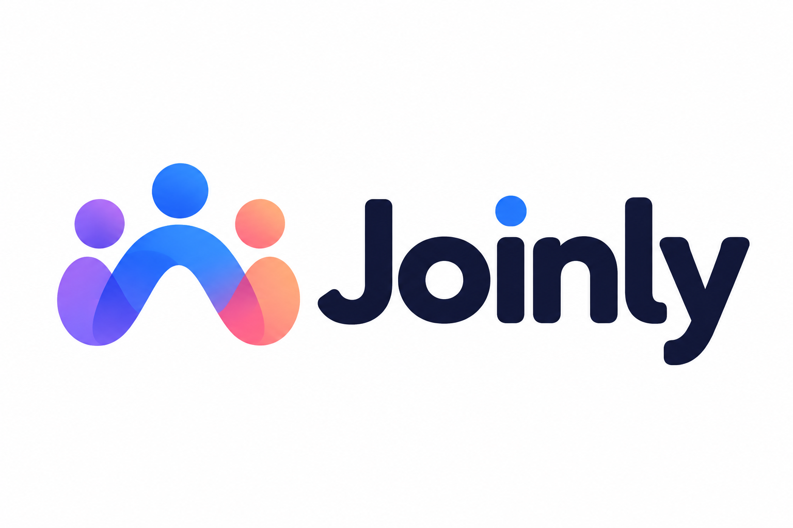

<p align="center">
  
</p>

# Joinly — par G1D Lab

**Découvrir des activités, réserver sa place et rencontrer de nouvelles personnes.**

Joinly est un projet de groupe porté par **G1D Lab**. Notre objectif est de
développer une application web full-stack de découverte et de réservation
d'activités, inspirée du principe de Meetup.

La plateforme permettra de réunir des personnes autour de centres d'intérêt
communs et de faciliter l'organisation d'événements : sorties, rencontres,
ateliers ou activités sportives et culturelles.

## État du projet

Le projet est en phase de conception. Ce dépôt contient une première version
statique du site : accueil, exemples d'activités et présentation du projet.
Les fonctionnalités décrites ci-dessous constituent le périmètre envisagé ;
elles ne sont pas encore implémentées dans ce dépôt.

## Objectifs

- Faciliter la découverte d'activités correspondant aux envies des utilisateurs.
- Simplifier la réservation d'une place et le suivi de ses inscriptions.
- Permettre aux organisateurs de publier et de gérer leurs événements.
- Adapter progressivement l'interface aux écrans d'ordinateur et de mobile, selon les priorités ci-dessous.
- Réaliser une application complète reliant interface web, serveur et base de données.

## Fonctionnalités prévues

| Domaine | Fonctionnalités envisagées |
| --- | --- |
| Comptes utilisateurs | Inscription avec différents rôles utilisateurs, connexion et modification du profil. |
| Découverte | Liste des activités et recherche par mots-clés ; recherche multicritère selon l'avancement. |
| Détail d'une activité | Description, date, lieu, organisateur et places disponibles. |
| Réservations | Inscription à une activité, annulation et consultation de ses réservations. |
| Organisation | Création et modification d'événements, gestion des capacités et des participants. |
| Interface | Page d'accueil ; adaptation responsive aux écrans d'ordinateur et de mobile selon l'avancement. |

## Exigences fonctionnelles et priorités

Les exigences suivantes reprennent les consignes fournies pour le projet.
Elles complètent les fonctionnalités propres à Joinly présentées ci-dessus.
Le niveau de priorité détermine ce qui doit être réalisé et ce qui pourra être
ajouté selon l'avancement du groupe.

La liste détaillée ci-dessous reprend les 22 fonctionnalités du tableau fourni.
Il s'agit d'exigences à développer, et non d'une liste de fonctionnalités déjà
implémentées.

| Liste des fonctionnalités | Priorité |
| --- | --- |
| Page d'accueil | **Élevée** |
| Inscription : création de compte avec différents profils | **Élevée** |
| Authentification | **Élevée** |
| Édition du profil | **Élevée** |
| FAQ | **Élevée** |
| CGU (conditions générales d'utilisation) et mentions légales | **Élevée** |
| Recherche simple par mot-clé | **Élevée** |
| Back-office : gestion des utilisateurs et des droits d'accès | **Élevée** |
| Back-office : gestion de la FAQ | **Élevée** |
| Back-office : gestion des CGU | **Élevée** |
| Back-office : gestion des mentions légales | **Élevée** |
| Contact | **Élevée** |
| Mot de passe oublié | **Moyenne** |
| Recherche avancée multicritère | **Moyenne** |
| Site responsive : adaptation à l'écran | **Moyenne** |
| Messagerie interne | **Faible** |
| Forum | **Faible** |
| Site accessible : adaptation aux handicaps | **Faible** |
| Site multilingue (voir la remarque ci-dessous) | **Faible** |
| Back-office : gestion du forum | **Faible** |
| Back-office : gestion de la messagerie interne | **Faible** |
| Back-office : gestion des aspects liés au rendu visuel | **Faible** |

**Remarque sur le document source :** la ligne du site multilingue indique
« Site multilangues (s'adapte aux handicaps) ». La parenthèse semble reprendre
par erreur celle de l'accessibilité ; sa signification est à confirmer avec le
tuteur et le client.

Les rôles utilisateurs et leurs permissions seront précisés lors de la
conception. Les exigences de priorité haute constituent le socle obligatoire ;
les niveaux moyen et bas restent conditionnés par l'avancement du projet.

### Fonctionnalités supplémentaires propres au projet

Les autres fonctionnalités liées à Joinly doivent être **validées par le tuteur
et le client**, en définissant leurs priorités. Le tableau source laisse leur
priorité à déterminer (« ? »).

Le document donne les exemples suivants : ajouter, modifier, afficher et
supprimer un ou plusieurs éléments du site (logement, œuvre d'art, animal,
événement, participant, locataire, tâche, etc.), proposer une carte interactive,
un chat ou un chatbot.

Pour Joinly, la gestion des activités, des événements, des participants et des
réservations présentée plus haut devra donc être validée avec ses priorités.
Les autres exemples ne deviennent pas automatiquement des exigences du projet.

## Parcours utilisateur envisagé

1. Découvrir les activités proposées.
2. Consulter les informations d'un événement.
3. Créer un compte ou se connecter.
4. Réserver une place, selon les disponibilités.
5. Retrouver ses inscriptions dans son espace personnel.
6. Participer à l'activité et rencontrer les autres participants.

## Architecture envisagée

Le projet sera organisé autour de trois composants :

- **Frontend** : interface de découverte, de réservation et de gestion des activités.
- **Backend / API** : authentification, règles de réservation et gestion des événements.
- **Base de données** : stockage des utilisateurs, des activités et des réservations.

Les technologies, la structure du code et les modalités de déploiement seront
précisées lorsque les choix techniques du groupe auront été validés.

## Identité visuelle

Le nom du produit est **Joinly** et celui de l'entreprise du projet est **G1D Lab**.
Les visuels explorent les thèmes de la rencontre, du lien et de la participation,
avec des formes humaines et des dégradés de bleu, violet, rose et orange.

| Fichier | Contenu |
| --- | --- |
| [logo.PNG](logo.PNG) | Logo Joinly avec symbole et nom, présenté en tête de ce README. |
| [logo1.PNG](logo1.PNG) | Planche de variantes et exemples d'utilisation de l'identité visuelle. |
| [logo2.PNG](logo2.PNG) | Symbole graphique seul. |

## Contenu du dépôt

```text
G1Dlab_joinly/
├── README.md
├── index.html
├── activites.html
├── a-propos.html
├── style.css
├── prompts.txt
├── logo.PNG
├── logo1.PNG
└── logo2.PNG
```

## Récupérer le projet

```bash
git clone https://github.com/wabo822/G1Dlab_joinly.git
cd G1Dlab_joinly
```

Pour voir le site, ouvrir `index.html` dans un navigateur (un double-clic suffit).
Aucune installation n'est nécessaire : les trois pages utilisent uniquement
HTML et CSS. Les activités sont des exemples fictifs ; les comptes et les
réservations ne sont pas encore disponibles.

## Prochaines étapes

- [x] Ajouter les premiers visuels Joinly.
- [x] Présenter le projet et son périmètre dans le README.
- [ ] Valider le périmètre fonctionnel et les parcours utilisateurs.
- [ ] Choisir les technologies du frontend, du backend et de la base de données.
- [ ] Concevoir les maquettes et le modèle de données.
- [ ] Réaliser toutes les exigences de priorité haute, y compris le back-office.
- [ ] Développer la découverte d'activités et la gestion des événements.
- [ ] Implémenter l'authentification et les réservations.
- [ ] Ajouter les fonctionnalités de priorité moyenne selon l'avancement.
- [ ] Étudier les extensions de priorité basse selon l'avancement.
- [ ] Tester les parcours, notamment les capacités et les annulations.
- [ ] Déployer l'application et compléter la documentation technique.

## Travail en équipe

Pour chaque évolution, créer une branche dédiée, rédiger des commits explicites
et ouvrir une pull request pour permettre une revue par le groupe. Mettre à jour
ce README lorsque les choix techniques ou les instructions de lancement évoluent.

**Projet :** Joinly · **Entreprise du projet :** G1D Lab
