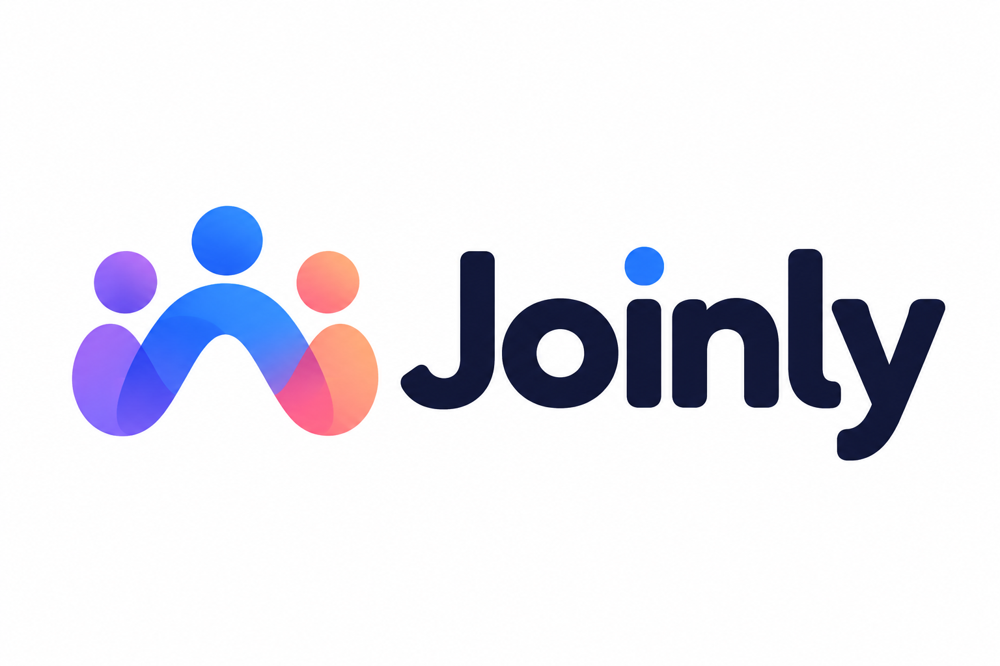

<p align="center">
  
</p>

# Joinly — par G1D Lab

**Découvrir des activités, réserver sa place et rencontrer de nouvelles personnes.**

Joinly est un projet de groupe porté par **G1D Lab**. Notre objectif est de
développer une application web full-stack de découverte et de réservation
d'activités, inspirée du principe de Meetup.

La plateforme permettra de réunir des personnes autour de centres d'intérêt
communs et de faciliter l'organisation d'événements : sorties, rencontres,
ateliers ou activités sportives et culturelles.

## État du projet

Une première version fonctionnelle est disponible : backend **Flask**, pages
HTML rendues côté serveur et base **PostgreSQL 16**. Elle couvre le socle de
priorité élevée : comptes, profils, recherche, inscriptions, espace organisateur,
administration, FAQ, pages légales et contact. Les pages adaptatives et les
filtres avancés sont également livrés. L’inscription demande au moins trois
centres d’intérêt. La page d’accueil propose « Recommandé pour vous » et un
classement « Tendances ». Une activité peut être gratuite ou avoir un prix en
euros ; le paiement est simulé, sans encaissement.

Le tri par note est disponible (`sort=rating`) : il utilise la moyenne des avis visibles. On peut mettre une activité en favori, suivre un organisateur, et ouvrir sa page publique.

Une activité devient **Terminée** quand son heure de fin est passée (Europe/Paris), sans tâche planifiée. Elle quitte l’accueil, le classement et la liste par défaut, reste visible par son lien, et se retrouve dans l’historique du participant ainsi que via « Voir les activités passées ». Les inscriptions se ferment aussi `BOOKING_CUTOFF_MINUTES` minutes avant le début (0 par défaut). La liste `/activities` se filtre par mot-clé, lieu, ville, catégorie, dates et prix, puis se trie et se pagine dans l’URL.

Les instructions de lancement, de test et d’exploitation sont dans
[docs/developpement.md](docs/developpement.md). La matrice des fonctionnalités
et leurs limites figurent dans [docs/recette-v1.md](docs/recette-v1.md).
Le dossier `joinly_front/` conserve la maquette d’origine ; l’application utilise
`app/templates/` et `app/static/`.

Le chatbot et les fonctions sociales restent des évolutions. Le prix d’une
activité est enregistré, mais aucun prestataire de paiement n’est branché : la
réservation payante s’arrête sur une confirmation simulée. La récupération du
mot de passe nécessite un serveur SMTP configuré. Les pages légales (mentions,
conditions d’utilisation, politique de confidentialité) sont rédigées pour ce
projet étudiant. Le journal des versions est dans [CHANGELOG.md](CHANGELOG.md).
Un jeu de données de démonstration se charge avec `flask --app app seed-demo`.
Il ne change pas le mot de passe d’un compte déjà présent ; il met à jour les
centres d’intérêt et les prix des données de démonstration. Les identifiants
sont dans [docs/demo-accounts.md](docs/demo-accounts.md).

## Objectifs

- Faciliter la découverte d'activités correspondant aux envies des utilisateurs.
- Simplifier la réservation d'une place et le suivi de ses inscriptions.
- Permettre aux organisateurs de publier et de gérer leurs événements.
- Adapter progressivement l'interface aux écrans d'ordinateur et de mobile, selon les priorités ci-dessous.
- Réaliser une application complète reliant interface web, serveur et base de données.

## Fonctionnalités du projet

| Domaine | Fonctionnalités envisagées |
| --- | --- |
| Comptes utilisateurs | Inscription avec différents rôles utilisateurs, connexion et modification du profil. |
| Découverte | Liste des activités et recherche par mots-clés ; recherche multicritère selon l'avancement. |
| Détail d'une activité | Description, date, lieu, organisateur, prix (ou Gratuit) et places disponibles. |
| Réservations | Inscription à une activité, annulation et consultation de ses réservations. |
| Organisation | Création et modification d'événements, gestion des capacités et des participants. |
| Interface | Page d'accueil ; adaptation responsive aux écrans d'ordinateur et de mobile selon l'avancement. |
| Assistant IA | Chatbot Joinly : recommandations selon le profil, réponses contextualisées sur le projet et questions générales. Fonction prévue, non implémentée. |

### Assistant IA Joinly et recommandations personnalisées

L'assistant entre dans le périmètre proposé avec une **priorité moyenne
proposée**, à valider avec le client après le socle obligatoire et la réservation.
Il ne correspond pas à la messagerie entre membres et n'est pas encore implémenté.

- **Recommandations** : avec l'accord du membre, utiliser ses centres d'intérêt,
  sa zone choisie et ses préférences déclarées pour suggérer jusqu'à trois
  activités existantes, à venir et disponibles. Donner une raison et un lien
  pour chaque proposition. Si le profil est vide, demander ses préférences.
- **Questions sur Joinly** : répondre à partir d'une courte présentation du
  projet, de règles et d'une FAQ validées, ajoutées directement au prompt.
  Signaler les informations manquantes et permettre de consulter l'aide source.
- **Questions générales** : converser avec le modèle en distinguant les réponses
  générales des informations fournies sur Joinly. Aucun accès au Web en temps
  réel n'est prévu pour le prototype.

**Prototype : API et prompt engineering.** Le serveur composera un prompt avec
les instructions, les extraits fixes validés, les préférences autorisées et une
courte liste d'activités sélectionnées par des filtres simples. Le modèle
existant génère la réponse, sans entraînement. Il n'y a ni moteur de recherche
documentaire ni index vectoriel : cette contextualisation simplifiée n'est pas
un véritable RAG. Une recherche documentaire automatique reste une évolution.
Les disponibilités proviennent de la base métier et doivent être revérifiées
lors de la réservation. Le modèle ne peut pas inventer d'activité ou de place.

L'assistant propose et explique, mais ne réserve, n'annule ni ne modifie le
profil. L'utilisateur agit dans les écrans habituels. Le profil d'autrui reste
inaccessible. L'utilisation de son profil est facultative et désactivable.
Pour la démonstration via API, utiliser des profils fictifs et une documentation
publique validée. Les clés API et les appels restent côté serveur, avec quotas,
délai maximal et message de repli en cas de panne.

**Cible d'exploitation : modèle local.** Remplacer l'API externe par un modèle
à poids ouverts hébergé sur une infrastructure contrôlée par le projet afin de
réduire les transmissions à des tiers. « Local » désigne cette infrastructure,
pas nécessairement l'ordinateur du visiteur. La licence, le matériel, la mémoire,
la qualité et les temps de réponse restent à valider. Le déploiement local ne
remplace pas les contrôles d'accès, de réseau, des journaux et des sauvegardes.
Aucun repli silencieux vers une API externe n'est prévu en exploitation locale.

Les exigences J08 à J12 et les scénarios R15 à R20 figurent dans le
[cahier des charges](docs/cahier-des-charges-joinly.md). Le modèle, les quotas,
le budget et les règles de conservation restent à définir.

## Modèle économique envisagé

Les pistes suivantes restent à valider avec le tuteur et le client. Le catalogue
peut déjà afficher un prix et une confirmation simulée ; la commission, l’abonnement
et l’encaissement réel ne sont pas implémentés. Les tarifs et commissions restent
à définir.

| Source de revenus | Mise en œuvre dans Joinly | Qui paie / ce que gagne Joinly |
| --- | --- | --- |
| Commission sur les réservations | Prélever une commission sur chaque réservation d'activité payante. | L'organisateur reverse une part du prix de la réservation à Joinly. |
| Location de matériel | Proposer à la réservation des chaussures ou bâtons de randonnée, raquettes ou tentes, selon les tailles et stocks disponibles. | Le participant paie le fournisseur ; Joinly reçoit une commission sur la location. |
| Services supplémentaires | Ajouter un panier-repas, un transport vers le lieu de rendez-vous ou des photos retouchées. | Le participant paie le prestataire ; Joinly reçoit une commission sur ces options. |
| Encadrement professionnel | Réserver un guide de randonnée, un coach d'escalade ou un mentor en photographie. | Le participant paie le professionnel ; Joinly reçoit une commission sur la prestation. |
| Formules d'activité | Proposer plusieurs formules : atelier seul, atelier avec matériel, ou expérience complète avec repas. | Le participant paie l'organisateur ; Joinly reçoit une commission sur la formule réservée. |
| Abonnement membre — Joinly Plus | Offrir des réductions sur certaines activités, des bons de location et un accès anticipé à certaines inscriptions. | Le membre paie un abonnement ; Joinly perçoit la cotisation, avec des avantages convenus avec les partenaires. |
| Abonnement organisateur Pro | Donner accès à davantage de publications, aux statistiques, au suivi des présences et à l'export des participants. | L'organisateur paie un abonnement ; Joinly perçoit la cotisation. |
| Sponsoring et publicité | Afficher des espaces publicitaires ou des activités sponsorisées clairement identifiés. | Une marque, un commerçant ou un organisateur paie Joinly pour la visibilité. |
| Offre entreprise / team building | Organiser des activités de groupe selon le budget, la date et le nombre de salariés. | L'entreprise paie les activités et des frais de coordination ; ces frais rémunèrent Joinly. |
| Affiliation | Recommander des équipements ou activités partenaires via des liens suivis. | Le partenaire verse une commission à Joinly lorsqu'un achat ou une réservation est attribué au lien. |
| Activités organisées par Joinly | Créer des soirées de rencontre, sorties urbaines ou sessions de jeux de société. | Les participants paient Joinly ; le revenu restant après les coûts d'organisation constitue sa marge. |
| Services ponctuels aux organisateurs | Proposer la configuration d'une page d'inscription, un service de photographie ou la gestion de l'accueil et du pointage sur place. | L'organisateur paie à la prestation ; Joinly conserve le montant restant après les coûts de réalisation. |

La location, les options, l'encadrement et les formules sont différentes offres
auxquelles peut s'appliquer la commission, sans cumuler automatiquement plusieurs
commissions sur une même vente. La navigation, la recherche et l'inscription aux
activités gratuites resteraient gratuites. La commission sur les réservations
constitue la piste principale ; les autres offres seraient ajoutées progressivement.

## Exigences fonctionnelles et priorités

Les exigences suivantes reprennent les consignes fournies pour le projet.
Elles complètent les fonctionnalités propres à Joinly présentées ci-dessus.
Le niveau de priorité détermine ce qui doit être réalisé et ce qui pourra être
ajouté selon l'avancement du groupe.

La liste détaillée ci-dessous reprend les 22 fonctionnalités du tableau fourni.
Le tableau exprime les priorités du projet. La matrice de recette distingue les
fonctionnalités livrées des extensions.

| Liste des fonctionnalités | Priorité |
| --- | --- |
| Page d'accueil | **Élevée** |
| Inscription : création de compte avec différents profils | **Élevée** |
| Authentification | **Élevée** |
| Édition du profil | **Élevée** |
| FAQ | **Élevée** |
| CGU (conditions générales d'utilisation) et mentions légales | **Élevée** |
| Recherche simple par mot-clé | **Élevée** |
| Back-office : gestion des utilisateurs et des droits d'accès | **Élevée** |
| Back-office : gestion de la FAQ | **Élevée** |
| Back-office : gestion des CGU | **Élevée** |
| Back-office : gestion des mentions légales | **Élevée** |
| Contact | **Élevée** |
| Mot de passe oublié | **Moyenne** |
| Recherche avancée multicritère | **Moyenne** |
| Site responsive : adaptation à l'écran | **Moyenne** |
| Messagerie interne | **Faible** |
| Forum | **Faible** |
| Site accessible : adaptation aux handicaps | **Faible** |
| Site multilingue (voir la remarque ci-dessous) | **Faible** |
| Back-office : gestion du forum | **Faible** |
| Back-office : gestion de la messagerie interne | **Faible** |
| Back-office : gestion des aspects liés au rendu visuel | **Faible** |

**Remarque sur le document source :** la ligne du site multilingue indique
« Site multilangues (s'adapte aux handicaps) ». La parenthèse semble reprendre
par erreur celle de l'accessibilité ; sa signification est à confirmer avec le
tuteur et le client.

Les rôles utilisateurs et leurs permissions seront précisés lors de la
conception. Les exigences de priorité haute constituent le socle obligatoire ;
les niveaux moyen et bas restent conditionnés par l'avancement du projet.

### Fonctionnalités supplémentaires propres au projet

Les autres fonctionnalités liées à Joinly doivent être **validées par le tuteur
et le client**, en définissant leurs priorités. Le tableau source laisse leur
priorité à déterminer (« ? »).

Le document donne les exemples suivants : ajouter, modifier, afficher et
supprimer un ou plusieurs éléments du site (logement, œuvre d'art, animal,
événement, participant, locataire, tâche, etc.), proposer une carte interactive,
un chat ou un chatbot.

Pour Joinly, la gestion des activités, des événements, des participants et des
réservations présentée plus haut devra donc être validée avec ses priorités.
Les autres exemples ne deviennent pas automatiquement des exigences du projet.

L'assistant IA décrit plus haut constitue une demande propre à Joinly,
avec une priorité moyenne proposée. Il s'ajoute aux exigences pédagogiques
sans modifier leurs priorités.

## Parcours utilisateur envisagé

1. Découvrir les activités proposées.
2. Consulter les informations d'un événement.
3. Créer un compte ou se connecter.
4. Réserver une place, selon les disponibilités.
5. Retrouver ses inscriptions dans son espace personnel.
6. Participer à l'activité et rencontrer les autres participants.

## Architecture envisagée

Le projet sera organisé autour de trois composants :

- **Frontend** : interface de découverte, de réservation et de gestion des activités.
- **Backend / API** : authentification, règles de réservation et gestion des événements.
- **Base de données** : stockage des utilisateurs, des activités et des réservations.

Le backend intégrera un service d'assistance IA par API avec contexte fixe
et recommandations. Un adaptateur permettra ensuite de passer au modèle local.
Le catalogue reste la source des disponibilités et les permissions s'appliquent
avant tout accès au profil.

Le moteur de base de données retenu est **PostgreSQL**. Le backend Flask se connecte à la base avec un compte applicatif limité.
Gunicorn sert les pages et les formulaires ; les mutations sont protégées par
un jeton CSRF et les autorisations sont vérifiées côté serveur.

Les instructions d’installation, de connexion, de test et les limites du schéma
figurent dans [database/README.md](database/README.md).

## Identité visuelle

Le nom du produit est **Joinly** et celui de l'entreprise du projet est **G1D Lab**.
Les visuels explorent les thèmes de la rencontre, du lien et de la participation,
avec des formes humaines et des dégradés de bleu, violet, rose et orange.

| Fichier | Contenu |
| --- | --- |
| [logo.PNG](joinly_front/logo.PNG) | Logo Joinly avec symbole et nom, présenté en tête de ce README. |
| [logo1.PNG](joinly_front/logo1.PNG) | Planche de variantes et exemples d'utilisation de l'identité visuelle. |
| [logo2.PNG](joinly_front/logo2.PNG) | Symbole graphique seul. |

## Contenu du dépôt

```text
G1Dlab_joinly/
├── app/                    # Backend Flask, templates et styles de la V1
├── database/               # Schéma et migrations PostgreSQL
├── scripts/                # Initialisation, contenu initial et service
├── tests/                  # Tests métier et parcours navigateur
├── deploy/                 # Service systemd Gunicorn
├── docs/                   # Cahier des charges et guide technique
├── requirements.txt        # Dépendances de l’application
└── joinly_front/            # Maquette statique historique
```

## Récupérer le projet

```bash
git clone https://github.com/wabo822/G1Dlab_joinly.git
cd G1Dlab_joinly
```

Pour lancer la version complète, suivre [le guide de développement](docs/developpement.md).
Ouvrir simplement `index.html` affiche uniquement la maquette historique : cela
ne démarre ni le backend ni les fonctionnalités de compte et de réservation.

## Déploiement

La V1 est en ligne sur **https://isep.wangjiahan.com**. Nginx relaie HTTPS vers
Gunicorn ; le certificat du sous-domaine et son renouvellement sont configurés.
Le domaine principal conserve sa configuration existante.

La version complète est exécutable sur cette machine avec Gunicorn et PostgreSQL.
Un service systemd est fourni pour la maintenir active sur `127.0.0.1:8000`.
L’accès distant de développement peut utiliser un tunnel SSH.

La configuration Hangar décrite initialement sert seulement les fichiers
statiques depuis `/var/www/html`. Elle doit être adaptée pour exécuter ou relayer
le backend Flask ; pousser le dépôt ne suffit pas à y déployer la V1. Aucun
déploiement Hangar ni changement de domaine n’a été effectué dans cette version.

## Prochaines étapes

- [x] Ajouter les premiers visuels Joinly.
- [x] Présenter le projet et son périmètre dans le README.
- [ ] Valider le périmètre fonctionnel et les parcours utilisateurs.
- [x] Choisir PostgreSQL et initialiser la base de développement.
- [x] Choisir Flask, Jinja et PostgreSQL pour la première version.
- [ ] Concevoir les maquettes et le modèle de données.
- [x] Réaliser le socle de priorité haute et le back-office, y compris les pages légales du projet étudiant.
- [x] Demander au moins trois centres d’intérêt, recommander des activités et afficher un classement.
- [x] Afficher un prix et une confirmation de paiement simulée, sans encaissement.
- [x] Développer la découverte d'activités et la gestion des événements.
- [x] Implémenter l'authentification et les réservations.
- [ ] Intégrer le chatbot par API, ses prompts contextualisés et les recommandations.
- [ ] Valider les réponses, les droits d'accès, les quotas et la cible de modèle local.
- [ ] Ajouter les fonctionnalités de priorité moyenne selon l'avancement.
- [ ] Étudier les extensions de priorité basse selon l'avancement.
- [x] Tester les parcours, notamment les capacités, les accès et les annulations.
- [ ] Configurer le domaine HTTPS, SMTP et les sauvegardes de production.

## Travail en équipe

Pour chaque évolution, créer une branche dédiée, rédiger des commits explicites
et ouvrir une pull request pour permettre une revue par le groupe. Mettre à jour
ce README lorsque les choix techniques ou les instructions de lancement évoluent.

**Projet :** Joinly · **Entreprise du projet :** G1D Lab
