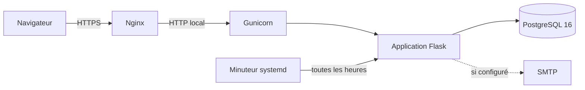

**Français** | [English](README.en.md) | [中文](README.zh-CN.md)

<p align="center">
  
</p>

<h1 align="center">Joinly</h1>

<p align="center">
  <strong>Découvrir une activité, réserver sa place, se retrouver.</strong>
</p>

<p align="center">
  
  
  
</p>

<p align="center">
  <a href="https://isep.wangjiahan.com"><strong>Démonstration en ligne — https://isep.wangjiahan.com</strong></a>
</p>

Projet étudiant du groupe **G1D Lab** à l’**ISEP** (École d’ingénieurs du numérique). Joinly est une application web de découverte et de réservation d’activités, du même ordre qu’une plateforme de rencontres autour d’un intérêt commun. Les pages sont rendues par Flask ; les données sont dans PostgreSQL 16.

Le dépôt ne comporte pas de fichier `LICENSE`. Voir [Équipe, crédits et licence](#équipe-crédits-et-licence).

## Sommaire

- [Présentation](#présentation)
- [Fonctionnalités](#fonctionnalités)
- [Captures d’écran](#captures-décran)
- [Pile technique](#pile-technique)
- [Architecture](#architecture)
- [Arborescence](#arborescence)
- [Installation locale](#installation-locale)
- [Variables d’environnement](#variables-denvironnement)
- [Tests](#tests)
- [Déploiement](#déploiement)
- [Sécurité](#sécurité)
- [Équipe, crédits et licence](#équipe-crédits-et-licence)
- [Documentation associée](#documentation-associée)

## Présentation

Organiser une sortie, un atelier ou une séance sportive demande aujourd’hui de disperser l’annonce, les inscriptions et le pointage. Le participant peine à comparer les dates, les lieux et les places restantes. L’organisateur peine à savoir qui vient, et à contrôler l’entrée sans exposer les adresses électroniques.

Joinly réunit ces étapes dans une seule application :

1. parcourir les activités publiées et ouvrir une fiche (description, horaire de Paris, lieu, tarif, places, carte si des coordonnées sont enregistrées) ;
2. créer un compte, confirmer son adresse, choisir au moins trois centres d’intérêt ;
3. vérifier un récapitulatif, puis réserver — gratuitement, ou après une confirmation de paiement **simulée** ;
4. recevoir un e-mail HTML avec un QR code et un lien de billet utilisable sans connexion ;
5. côté organisateur, publier l’activité, suivre le remplissage et scanner les billets ;
6. côté administration, modérer les comptes, les contenus et les avis.

L’interface livrée est en français. Le paiement n’encaisse rien : une activité dont le prix est supérieur à zéro demande seulement la case « Paiement simulé — projet étudiant ». Aucune carte bancaire n’est collectée.

Le dossier `joinly_front/` conserve la maquette statique d’origine. L’application exécutable est `app/`. Ouvrir `index.html` ne démarre ni Flask ni la base.

## Fonctionnalités

Les rôles sont `member`, `organizer` et `admin`. Ils sont cumulables. L’inscription publique permet de choisir membre ou organisateur ; personne ne peut s’attribuer le rôle administrateur. Un membre peut aussi déposer une demande d’habilitation, traitée dans l’administration.

### Participant

- **Catalogue.** Page d’accueil, liste `/activities` filtrée par mot-clé, lieu, ville, catégorie, dates et prix, triée (date, popularité, prix, note) et paginée dans l’URL. Les activités terminées quittent les listes par défaut ; elles restent accessibles par leur lien et dans l’historique.
- **Fiche.** Description, début et fin en Europe/Paris, lieu, organisateur, tarif ou « Gratuit », places restantes, photo de couverture (envoi de l’organisateur ou visuel de catégorie, avec crédit). Si une latitude et une longitude sont enregistrées, une carte Leaflet s’affiche sur les tuiles OpenStreetMap France.
- **Recommandations et classement.** Au moins trois centres d’intérêt sont exigés (l’administrateur en est dispensé). L’accueil propose « Recommandé pour vous ». La page `/classement` classe les activités publiées à venir.
- **Favoris et suivis.** Mise en favori d’une activité, abonnement à un organisateur, page publique de l’organisateur.
- **Avis.** Après la fin de l’activité, un participant encore inscrit laisse une note de 1 à 5 et un commentaire, modifiable. Un avis masqué par l’administration sort de la moyenne.
- **Réservation en deux temps.** Le bouton mène à une page de récapitulatif (date, lieu, organisateur, tarif, places, politique d’annulation, identité du participant). La place n’est créée qu’après la case « J’ai vérifié ces informations ». Une activité payante exige en plus la confirmation du paiement simulé.
- **Annulation.** Avant le début, selon la politique de l’activité : souple (intégral jusqu’à 24 h avant, sinon rien), modérée (intégral jusqu’à 72 h, sinon la moitié), stricte (rien). Le montant est un remboursement simulé. La place se libère et le billet est invalidé.
- **Billet et e-mail.** Chaque inscription confirmée reçoit un code court `JOIN-XXXX-XX` et un jeton imprévisible. L’e-mail de confirmation est en HTML, avec le QR code en image jointe et un lien vers `/billets/<jeton>`. Cette page de billet **ne demande pas de connexion**.
- **Rappel.** La commande `send-reminders` prévient une seule fois, par notification et par e-mail, chaque inscription confirmée dont l’activité commence dans les 24 heures. Le minuteur systemd qui l’exécute est horaire ; `scripts/install-service.sh` ne l’installe pas.
- **Compte.** Profil, avatar (JPEG, PNG ou WebP, recadré en carré ; à défaut, les initiales), changement d’adresse et de mot de passe, historique, cloche de notifications.
- **Compte et accès.** Inscription, code de confirmation à six chiffres, connexion, déconnexion. Connexion Google si les deux variables OAuth sont définies ; sinon le bouton est absent. Mot de passe oublié par lien SMTP à usage unique, valable 30 minutes, lorsque le courrier est configuré.
- **Pages publiques.** Contact, FAQ, conditions d’utilisation, mentions légales, politique de confidentialité, bandeau « cookies nécessaires » (cookie de session uniquement), partage du lien et téléchargement d’une affiche PNG.

### Organisateur

- **Publication.** Création et modification d’une activité en brouillon ou publiée : titre, description, lieu, ville, coordonnées, dates, capacité, prix, politique d’annulation, image de couverture. Les dates d’une activité déjà terminée ne sont plus modifiables par l’organisateur.
- **Annulation d’activité.** Les inscriptions confirmées sont annulées avec un remboursement simulé intégral.
- **Participants.** Liste des inscrits confirmés (nom affiché, date d’inscription, état du contrôle). Les adresses électroniques ne sont pas affichées.
- **Contrôle QR.** Page « Contrôle des billets » : saisie du code ou scan par la caméra (`BarcodeDetector`, sinon html5-qrcode). Un billet n’est accepté qu’une fois, pour cette activité, et seulement s’il est encore confirmé. Le contrôle peut être annulé.
- **Tableau de bord.** `/organizer` et `/organizer/tableau` : consultations, taux de remplissage, revenu simulé (inscriptions confirmées moins les remboursements), note moyenne, activités suivies, graphiques SVG sur 7, 30 ou 90 jours.

### Administration

L’espace `/admin` est réservé au rôle `admin`. Le tableau de bord affiche les comptes, le taux d’adresses confirmées, les activités ouvertes, les réservations, le revenu simulé, la note moyenne et les messages en attente, avec des graphiques SVG sur 7, 30 ou 90 jours.

- Comptes : recherche, statut (actif, suspendu, banni), export CSV, traitement groupé, fiche, mot de passe, avatar, consultation d’un compte (bandeau dédié, action journalisée). Un administrateur ne modifie pas ses propres droits et ne suspend pas son propre compte.
- Activités et réservations : listes filtrables, exports CSV, correction de prix et de dates, image de couverture, remboursement simulé manuel.
- Avis : modification ou masquage ; export CSV.
- Catégories, bibliothèque de couvertures, FAQ et nouvelles versions des pages légales (l’ancienne version reste en base).
- Demandes de contact et demandes pour devenir organisateur.
- Message interne à tous les comptes, aux organisateurs ou aux adresses non confirmées (notification dans l’application, pas un e-mail).
- Journal d’audit.
- Réglages : nom du site, bandeau, délai de clôture des inscriptions, politique d’annulation par défaut, poids du classement, activités épinglées.

### Hors de cette version

Ces sujets figurent dans le [cahier des charges](docs/cahier-des-charges-joinly.md) ou dans la [recette](docs/recette-v1.md) comme non livrés. Aucun code ne les réalise :

- assistant conversationnel et appels à un modèle d’IA (le consentement est seulement enregistré) ;
- messagerie interne et forum ;
- encaissement réel (aucun prestataire de paiement) ;
- interface multilingue ;
- audit d’accessibilité complet ;
- sauvegardes automatiques (un `pg_dump` manuel est documenté dans `database/README.md`).

## Captures d’écran

**Aucune capture d’interface n’est versionnée.** Le dossier [`docs/screenshots/`](docs/screenshots/README.md) est un emplacement vide, prévu pour de vrais fichiers PNG ou WebP (`accueil.png`, `catalogue.png`, `fiche-activite.png`, `confirmation.png`, `billet.png`, `controle.png`, `tableau-organisateur.png`, `administration.png`). Il ne faut pas y déposer une image générée à la place d’une capture.

Les logos du dépôt (`joinly_front/logo.PNG`, `logo1.PNG`, `logo2.PNG`) et les couvertures d’activités ne sont pas des captures d’écran.

## Pile technique

| Composant | Rôle dans Joinly |
| --- | --- |
| Python 3.12 | Version utilisée pour la recette documentée. |
| Flask 3.1.3, Jinja | Pages HTML, formulaires, commandes `flask`. Pas d’étape de compilation JavaScript. |
| Flask-WTF 1.2.2 | Jeton CSRF sur les formulaires POST. |
| PostgreSQL 16, psycopg 3.2.10 | Données métier. Connexion avec le rôle applicatif `joinly_app`. |
| Gunicorn 23.0.0 | Serveur WSGI, deux workers, écoute locale. |
| Nginx | Terminaison HTTPS et relais vers Gunicorn. |
| Pillow 11.3.0 | Couvertures, avatars, affiche PNG. |
| qrcode 8.2 | QR des billets et de l’e-mail de confirmation. |
| Authlib 1.6.5 | Échange de jeton pour la connexion Google, si elle est configurée. |
| pytest 8.4.2, Playwright 1.56.0 | Tests automatisés et parcours navigateur. |
| Leaflet 1.9.4, html5-qrcode 2.3.8 | Chargés depuis unpkg, seuls hôtes de script autorisés en plus de l’application. |
| Source Sans 3 | Police auto-hébergée (`app/fonts/`), licence SIL OFL. |

## Architecture

Le navigateur ne parle qu’à Nginx. Nginx relaie vers Gunicorn sur la machine. Flask rend les pages, applique les règles de réservation dans des transactions, et lit PostgreSQL. Le courrier part par SMTP seulement si l’envoi est configuré. Un minuteur systemd, distinct du service web, lance la commande de rappel.



Les modules principaux :

| Module | Rôle |
| --- | --- |
| `app/__init__.py` | Fabrique l’application, les routes et les contrôles d’accès. |
| `app/tickets.py` | Jeton de billet, code court, image QR. |
| `app/notify.py` | Notifications, e-mails HTML, code de confirmation, rappels. |
| `app/lifecycle.py` | Activité terminée, clôture des inscriptions, remboursement simulé. |
| `app/dashboards.py`, `app/charts.py` | Indicateurs et graphiques SVG, sans script externe. |
| `app/admin_office.py` | Listes, exports, réglages, journal, diffusion. |
| `app/avatars.py`, `app/covers.py`, `app/posters.py` | Avatar, couverture, affiche. |

Le statut « Terminée » n’est pas stocké : chaque requête compare `ends_at` à l’instant présent, en Europe/Paris. Les inscriptions se ferment aussi `BOOKING_CUTOFF_MINUTES` minutes avant le début (0 par défaut : à l’heure de début), ou lorsque la capacité est atteinte.

## Arborescence

```text
G1Dlab_joinly/
├── app/                         # Application Flask, gabarits, styles, police
│   ├── templates/               # Pages Jinja
│   ├── static/                  # CSS, JS, couvertures, favicon
│   └── fonts/                   # Source Sans 3
├── database/
│   ├── migrations/              # 001_initial.sql … 016_avatars.sql
│   ├── scripts/setup-local.py   # Création de la base locale
│   └── tests/constraints.sql
├── deploy/                      # Unités systemd, minuteur, exemple Nginx
├── docs/                        # Cadrage, recette, crédits photo, captures
├── joinly_front/                # Maquette statique historique
├── scripts/                     # Migrations, contenu initial, service
├── tests/                       # pytest et parcours Playwright
├── requirements.txt
├── requirements-dev.txt
└── .env.example                 # Noms des variables, sans secret
```

Migrations, dans l’ordre : schéma initial et rôles ; sessions, contact et limites de débit ; pages de confidentialité ; centres d’intérêt et prix ; ville ; avis ; favoris et abonnements ; couvertures ; coordonnées ; notifications ; confirmation d’adresse ; billets ; annulations et remboursements simulés ; connexion Google ; administration ; avatars.

## Installation locale

Ubuntu, avec PostgreSQL local. Depuis la racine du dépôt :

```bash
sudo apt-get update
sudo apt-get install python3-venv postgresql postgresql-client
python3 -m venv .venv
.venv/bin/pip install -r requirements.txt
sudo python3 database/scripts/setup-local.py
sudo python3 scripts/migrate.py
```

`setup-local.py` crée la base `joinly`, le propriétaire `joinly_owner` (sans connexion applicative) et le rôle `joinly_app` (sans droit de créer des tables). Il écrit un mot de passe aléatoire dans `.env` (mode 600) et refuse une base, un rôle ou un `.env` déjà présents. Sur une machine déjà initialisée, ne relancer que `scripts/migrate.py`.

Ajouter dans `.env` une `SECRET_KEY` longue, distincte du mot de passe de la base :

```bash
python3 -c 'import secrets; print(secrets.token_hex(32))'
```

Contenu de référence, puis jeu de démonstration idempotent :

```bash
.venv/bin/python scripts/seed.py
.venv/bin/flask --app app seed-demo
```

`scripts/seed.py` ajoute les catégories, la FAQ et les textes légaux manquants. S’il n’existe aucun administrateur, il crée `admin@joinly.test` et écrit le mot de passe uniquement dans `.local/initial-admin.txt` (mode 600). `flask --app app seed-demo` ajoute des comptes `@demo.joinly.fr` et des activités en Île-de-France. Il ne supprime rien et ne change pas le mot de passe d’un compte déjà présent. Les identifiants de démonstration sont dans [docs/demo-accounts.md](docs/demo-accounts.md).

Autre administrateur, mot de passe saisi sans affichage :

```bash
.venv/bin/flask --app app create-admin
```

Lancement :

```bash
.venv/bin/gunicorn --workers 2 --bind 127.0.0.1:8000 'app:create_app()'
```

Ouvrir `http://127.0.0.1:8000`. Pour le rechargement automatique, `flask --app app run` reste réservé à la machine locale. Le point `GET /health` interroge la base et répond `{"status": "ok"}`.

Nettoyage des sessions, jetons et limites de débit expirés :

```bash
.venv/bin/flask --app app cleanup
```

## Variables d’environnement

Les noms ci-dessous sont ceux lus par l’application, par libpq ou par les scripts. Les valeurs restent dans `.env` ou dans le fichier d’environnement du service. Ne pas les committer. `.env.example` reprend les mêmes noms sans secret réel.

| Nom | Rôle |
| --- | --- |
| `PGHOST` | Hôte PostgreSQL. Lu par libpq (`psql`, psycopg). |
| `PGPORT` | Port PostgreSQL. |
| `PGDATABASE` | Nom de la base. L’application utilise `joinly` si la variable est absente. Les tests utilisent `joinly_test`. |
| `PGUSER` | Rôle de connexion. Le rôle livré par le script local est `joinly_app`. |
| `PGPASSWORD` | Mot de passe de ce rôle. |
| `SECRET_KEY` | Signature des sessions et des jetons. L’application refuse de démarrer sans elle. |
| `COOKIE_SECURE` | `1` : cookie de session `Secure` et en-tête HSTS. `0` : HTTP local uniquement. |
| `PUBLIC_BASE_URL` | Origine publique, sans barre finale. Liens de réinitialisation, URL canoniques, Open Graph, `sitemap.xml`, liens de billets. |
| `SMTP_HOST` | Serveur SMTP. Sans ce nom ou sans `MAIL_FROM`, aucun message n’est envoyé. |
| `SMTP_PORT` | Port SMTP. Défaut 587, avec STARTTLS. |
| `SMTP_USER` | Identifiant SMTP, si le serveur authentifie. |
| `SMTP_PASSWORD` | Secret SMTP associé. |
| `MAIL_FROM` | Adresse d’expédition. |
| `GOOGLE_CLIENT_ID` | Client OAuth Google. Les deux variables sont nécessaires ; sinon le bouton n’existe pas et `/auth/google` répond 404. |
| `GOOGLE_CLIENT_SECRET` | Secret du client OAuth. |
| `JOINLY_UPLOAD_DIR` | Dossier persistant des couvertures et des avatars. En production, hors du répertoire de release. |
| `BOOKING_CUTOFF_MINUTES` | Minutes avant le début où les inscriptions ferment. Défaut 0. |
| `TRUST_PROXY` | `1` seulement derrière le reverse proxy local de confiance. Un seul saut est lu pour l’adresse et le protocole. |
| `TRUSTED_HOSTS` | Hôtes autorisés, séparés par des virgules. |
| `UNSPLASH_ACCESS_KEY` | Clé lue uniquement par `scripts/fetch_unsplash_covers.py`. L’application web ne l’utilise pas. |

Sans SMTP, le code de confirmation est écrit dans le journal et dans la table `dev_outbox`. L’échec d’envoi d’une notification est journalisé et n’annule pas la réservation.

## Tests

Les tests pytest utilisent **uniquement** la base `joinly_test`. Ne pas y placer de données réelles et ne pas lancer deux suites en parallèle sur cette base.

```bash
.venv/bin/pip install -r requirements-dev.txt
sudo python3 scripts/setup-test-db.py
.venv/bin/python -m pytest -q
```

`setup-test-db.py` ne s’exécute qu’une fois. Les migrations manquantes de la base de test se réappliquent avec `sudo python3 scripts/migrate.py --database joinly_test`.

Parcours navigateur, après installation de Chromium :

```bash
.venv/bin/playwright install --with-deps chromium
PGDATABASE=joinly_test .venv/bin/gunicorn --bind 127.0.0.1:8001 'app:create_app()'
.venv/bin/python tests/browser_smoke.py
```

`tests/browser_smoke.py` réinitialise `joinly_test`, enchaîne un parcours organisateur, membre et administrateur, et contrôle les largeurs 375, 768 et 1440 px. Les contraintes SQL de base se vérifient avec `database/tests/constraints.sql`, comme indiqué dans [database/README.md](database/README.md).

## Déploiement

La démonstration publique est servie en HTTPS sur [https://isep.wangjiahan.com](https://isep.wangjiahan.com). Le schéma versionné, sans adresse IP ni secret, est le suivant.

1. Appliquer les migrations manquantes avec `sudo python3 scripts/migrate.py`, en tant qu’administrateur PostgreSQL local, sous le rôle propriétaire `joinly_owner`. Le rôle de l’application n’a pas le droit de modifier le schéma.
2. `sudo bash scripts/install-service.sh` copie l’application dans un nouveau répertoire sous `/opt/joinly/releases/`, puis fait pointer le lien `/opt/joinly/current` vers cette copie. Les anciennes copies restent en place pour un retour arrière du code. L’environnement virtuel `/opt/joinly/venv` est partagé. `/etc/joinly.env` n’est créé qu’à la première installation.
3. L’unité `deploy/joinly.service` lance Gunicorn sous l’utilisateur système `joinly`, lié à l’interface locale, avec un système de fichiers en lecture seule et un dossier d’envoi inscriptible hors des releases (`JOINLY_UPLOAD_DIR`, dans le script : `/var/lib/joinly/uploads`).
4. Nginx termine TLS, limite le corps des requêtes à 3 Mo, et relaie vers ce Gunicorn local. Il remplace `X-Forwarded-For` par l’adresse du client et `X-Forwarded-Proto` par le protocole reçu. Le service de production active `TRUST_PROXY` uniquement dans ce montage. Gunicorn n’est pas exposé directement.
5. Les rappels sont une unité oneshot distincte, `deploy/joinly-reminders.service`, déclenchée par `deploy/joinly-reminders.timer` (`OnCalendar=hourly`). Elle exécute `flask --app app send-reminders` : une notification et un e-mail, une seule fois, pour chaque inscription confirmée dont l’activité commence dans les 24 heures. Le script d’installation du service web ne copie pas ce minuteur.

Après une mise à jour : migrations, tests, puis nouvel appel du script d’installation et vérification de `GET /health`. Une migration de données déjà appliquée ne se réécrit pas. Les sauvegardes et la restauration ne sont pas automatisées par ces unités.

Le détail d’exploitation, y compris le branchement SMTP sans déposer de secret dans Git, est dans [docs/developpement.md](docs/developpement.md).

## Sécurité

- **CSRF.** `CSRFProtect` (Flask-WTF) couvre les formulaires POST. Le jeton vit 12 heures, comme la session. Un jeton absent ou périmé renvoie une page 400.
- **CSP stricte.** Chaque réponse porte `Content-Security-Policy` : `default-src 'self'` ; scripts et feuilles limités à l’origine et à unpkg (Leaflet, scanner) ; images limitées à l’origine, `data:` et aux tuiles OpenStreetMap ; `form-action 'self'` ; `frame-ancestors 'none'` ; `base-uri 'self'`. Aucune directive `unsafe-inline` ni `unsafe-eval` n’est accordée aux scripts. Les graphiques sont des SVG produits par le serveur.
- **Autres en-têtes.** `X-Content-Type-Options: nosniff`, `X-Frame-Options: DENY`, `Referrer-Policy: strict-origin-when-cross-origin`. HSTS (`max-age=31536000`) lorsque `COOKIE_SECURE=1`.
- **Session.** Cookie `HttpOnly`, `SameSite=Lax`, et `Secure` si `COOKIE_SECURE=1`. Le serveur ne conserve que l’empreinte du jeton. La session expire après 12 heures et est révoquée à la déconnexion, à la suspension, au changement d’habilitation ou au changement d’identifiants.
- **Mots de passe.** Hachage scrypt (Werkzeug). Longueur exigée : 12 à 128 caractères. La réinitialisation stocke l’empreinte du lien, à usage unique.
- **Accès.** Le rôle est vérifié côté serveur. Les écritures de capacité verrouillent la ligne d’activité (`SELECT … FOR UPDATE`). Les connexions, inscriptions, contacts et réinitialisations ont une limite de débit en base.
- **Proxy.** `TRUST_PROXY=1` n’active qu’un saut pour `X-Forwarded-For` et `X-Forwarded-Proto`. L’hôte transmis n’est pas utilisé. `TRUSTED_HOSTS` restreint les noms acceptés.
- **Fichiers.** Une couverture ou un avatar est refusé au-delà de 2 Mo ; la requête est limitée à 3 Mo. Le type est contrôlé avant réécriture en WebP.
- **Billets.** Le jeton public est long et aléatoire. La page de billet est en `noindex`. Le contrôle refuse un billet inconnu, annulé, déjà utilisé ou destiné à une autre activité.

## Équipe, crédits et licence

**Projet :** Joinly  
**Groupe :** G1D Lab  
**Établissement :** ISEP, École d’ingénieurs du numérique

Le dépôt ne fixe pas de liste nominative des membres du groupe. L’identité de l’éditeur et du responsable du traitement est celle publiée par les pages légales de l’application (`app/legal_content.py`), que l’administration peut remplacer par une nouvelle version.

Crédits photographiques des couvertures : [docs/image-credits.md](docs/image-credits.md) et `app/static/covers/credits.json`. La police Source Sans 3 est distribuée sous SIL Open Font License (`app/fonts/OFL-SourceSans3.md`).

**Licence du code :** absente. Aucun fichier `LICENSE` ni champ de licence n’accompagne ce dépôt. Les droits sur le code de l’application ne sont donc pas accordés par une licence libre dans l’état actuel du projet.

## Documentation associée

| Document | Contenu |
| --- | --- |
| [docs/developpement.md](docs/developpement.md) | Installation, service, courrier, exploitation. |
| [docs/recette-v1.md](docs/recette-v1.md) | Matrice de recette du socle et limites explicites. |
| [docs/cahier-des-charges-joinly.md](docs/cahier-des-charges-joinly.md) | Exigences et priorités du cours, y compris les sujets non développés. |
| [docs/demo-accounts.md](docs/demo-accounts.md) | Comptes du jeu de démonstration. |
| [database/README.md](database/README.md) | Schéma, migrations, sauvegarde manuelle. |
| [CHANGELOG.md](CHANGELOG.md) | Journal des évolutions livrées. |
