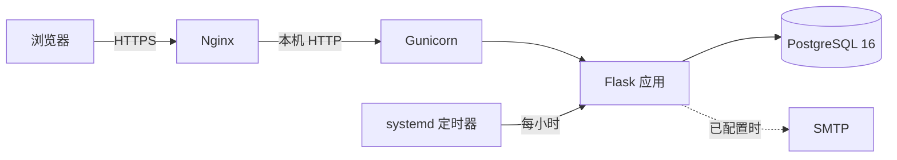

[Français](README.md) | [English](README.en.md) | **中文**

<p align="center">
  
</p>

<h1 align="center">Joinly</h1>

<p align="center">
  <strong>发现活动，预订席位，赴约相见。</strong>
</p>

<p align="center">
  
  
  
</p>

<p align="center">
  <a href="https://isep.wangjiahan.com"><strong>在线演示 — https://isep.wangjiahan.com</strong></a>
</p>

**G1D Lab** 小组在 **ISEP**（École d’ingénieurs du numérique，数字工程师学院）完成的课程项目。Joinly 是一个发现并预订活动的 Web 应用，形态接近按共同兴趣组织见面的平台。页面由 Flask 渲染，数据存放在 PostgreSQL 16。

仓库没有 `LICENSE` 文件。见[团队、署名与许可](#团队署名与许可)。

## 目录

- [项目概述](#项目概述)
- [功能](#功能)
- [界面截图](#界面截图)
- [技术栈](#技术栈)
- [架构](#架构)
- [目录结构](#目录结构)
- [本地安装](#本地安装)
- [环境变量](#环境变量)
- [支付（测试模式）](#支付测试模式)
- [测试](#测试)
- [部署](#部署)
- [安全](#安全)
- [团队、署名与许可](#团队署名与许可)
- [相关文档](#相关文档)

## 项目概述

一次郊游、工作坊或运动局，通知、报名和入场核验往往散落在不同工具里。参与者要自己比对时间、地点和剩余名额。组织者要知道谁会来，又不能在核验时暴露电子邮件地址。

Joinly 把这些步骤放进同一个应用：

1. 浏览已发布的活动并打开详情（说明、巴黎时间、地点、价格、名额；若已保存坐标，则显示地图）；
2. 注册账号、确认邮箱，并至少选择三个兴趣；
3. 核对确认摘要后再预订——免费活动直接确认，收费活动走 Stripe **测试模式**；
4. 收到一封带二维码的 HTML 邮件，以及无需登录即可打开的票据链接；
5. 组织者发布活动、查看上座情况并扫描票据；
6. 管理员审核账号、内容和评价。

已交付的界面语言为法语。价格为 0 欧元的活动不经过支付。收费活动只跳转到 Stripe Checkout 的测试模式，见[支付（测试模式）](#支付测试模式)。

`joinly_front/` 保留最初的静态原型。可运行的应用在 `app/`。直接打开 `index.html` 不会启动 Flask，也不会连接数据库。

## 功能

角色为 `member`、`organizer` 和 `admin`，可以同时拥有。公开注册只能选择成员或组织者，不能自行取得管理员角色。成员也可以提交成为组织者的申请，由管理员处理。

### 参与者

- **目录。** 首页和 `/activities`。可按关键词、地点、城市、类别、日期和价格筛选，可按日期、热度、价格或评分排序，分页状态写在 URL 中。已结束的活动离开默认列表，仍可通过链接和参与者历史记录打开。
- **活动详情。** 说明、欧洲/巴黎时区的开始与结束时间、地点、组织者、价格或「免费」、剩余名额、封面（组织者上传，或该类别的配图并附署名）。若保存了纬度和经度，页面用 Leaflet 显示 OpenStreetMap France 底图。
- **推荐与排行。** 至少选择三个兴趣（管理员免除此步骤）。首页提供「为你推荐」。`/classement` 对尚未结束的已发布活动排名。
- **收藏与关注。** 收藏活动、关注组织者，并打开组织者的公开页。
- **评价。** 活动结束后，报名仍为确认状态的参与者可以留下 1 到 5 分和一段评论，之后可以修改。被管理员隐藏的评价不计入平均分。
- **两步预订。** 按钮先打开确认页（日期、地点、组织者、价格、名额、取消政策、参与者身份）。免费席位只在勾选「我已核对以上信息」之后创建。收费活动接着打开 Stripe Checkout；席位保留 30 分钟，等 webhook 之后才确认。
- **取消。** 开始之前按活动政策计算：灵活（开始前 24 小时内全额，否则为零）、适中（开始前 72 小时内全额，否则一半）、严格（不退）。测试模式中已支付的报名会按该金额发起 Stripe 退款。席位释放，票据作废。
- **票据与邮件。** 每笔确认的报名得到短码 `JOIN-XXXX-XX` 和一段不可猜测的令牌。确认邮件为 HTML，内嵌二维码，并链到 `/billets/<令牌>`。该票据页**不要求登录**。
- **提醒。** `send-reminders` 对每笔将在 24 小时内开始的已确认报名只通知一次（站内通知和电子邮件）。执行它的 systemd 定时器每小时运行；`scripts/install-service.sh` 不会安装该定时器。
- **账户。** 资料、头像（JPEG、PNG 或 WebP，裁成正方形；否则显示姓名首字母）、修改邮箱和密码、历史记录、通知铃铛。
- **登录与注册。** 注册、六位确认码、登录、退出。仅当两个 OAuth 变量都已设置时才显示 Google 登录，否则按钮不出现。邮件配置完成后，可通过一次性 SMTP 链接重置密码，链接有效期 30 分钟。
- **公开页面。** 联系、常见问题、使用条款、法律声明、隐私政策、「必要 Cookie」提示（仅会话 Cookie）、分享链接，以及下载 PNG 海报。

### 组织者

- **发布。** 以草稿或已发布状态创建和修改活动：标题、说明、地点、城市、坐标、时间、容量、价格、取消政策、封面。活动已经结束后，组织者不能再改日期。
- **取消活动。** 已确认的报名被取消。测试模式中已支付的席位通过 Stripe 退款。
- **参与者名单。** 列出已确认的报名（显示名、报名时间、检票状态）。不显示电子邮件地址。
- **二维码检票。** 「票据核验」页：手输短码，或用摄像头扫描（优先 `BarcodeDetector`，否则 html5-qrcode）。一张票只能通过一次，且必须属于这场活动、报名仍为确认状态。检票可以撤销。
- **仪表板。** `/organizer` 与 `/organizer/tableau`：浏览量、上座率、模拟收入（已确认报名减去退款）、实收（测试支付减去退款）、近期报名的支付状态、平均分、被关注的活动，以及 7、30 或 90 天的 SVG 图表。

### 管理员

`/admin` 仅 `admin` 角色可进。仪表板显示账户数、邮箱确认比例、开放中的活动、预订、模拟收入、实收、平均分和待处理消息，并提供 7、30 或 90 天的 SVG 图表。预订列表显示支付状态。

- 账户：搜索，状态（正常、暂停、封禁），CSV 导出，批量处理，资料、密码、头像，以及「以该用户身份查看」（有专用提示条，并写入审计日志）。管理员不能修改自己的权限，也不能暂停自己的账户。
- 活动与预订：可筛选列表、CSV 导出、改正价格和日期、封面、手工录入模拟退款。
- 评价：修改或隐藏；CSV 导出。
- 类别、封面库、常见问题，以及法律页面的新版本（旧版本保留在数据库中）。
- 联系消息，以及成为组织者的申请。
- 向全部账户、组织者或尚未确认邮箱的账户发送站内消息（应用内通知，不是电子邮件）。
- 审计日志。
- 设置：站点名称、横幅、报名截止时间、默认取消政策、排行权重、置顶活动。

### 本版本未包含

下列内容在[需求说明](docs/cahier-des-charges-joinly.md)或[验收记录](docs/recette-v1.md)中标明为未交付，代码中也没有对应实现：

- 对话助手，以及对人工智能模型的调用（只保存同意与否）；
- 站内私信和论坛；
- 测试模式以外的收款（Stripe 正式密钥会被拒绝）；
- 多语言界面；
- 完整的无障碍审计；
- 自动备份（`database/README.md` 记录了手工 `pg_dump`）。

## 界面截图

**仓库中没有界面截图。** [`docs/screenshots/`](docs/screenshots/README.md) 是空的占位目录，供以后放入真实的 PNG 或 WebP（`accueil.png`、`catalogue.png`、`fiche-activite.png`、`confirmation.png`、`billet.png`、`controle.png`、`tableau-organisateur.png`、`administration.png`）。不要用生成的图片代替截图。

仓库里的标志（`joinly_front/logo.PNG`、`logo1.PNG`、`logo2.PNG`）和活动封面都不是界面截图。

## 技术栈

| 组件 | 在 Joinly 中的作用 |
| --- | --- |
| Python 3.12 | 文档所载验收所用版本。 |
| Flask 3.1.3、Jinja | HTML 页面、表单、`flask` 命令。没有 JavaScript 构建步骤。 |
| Flask-WTF 1.2.2 | POST 表单上的 CSRF 令牌。 |
| PostgreSQL 16、psycopg 3.2.10 | 业务数据。连接使用角色 `joinly_app`。 |
| Gunicorn 23.0.0 | WSGI 服务器，两个 worker，只监听本机。 |
| Nginx | 终止 HTTPS，并反向代理到 Gunicorn。 |
| Pillow 11.3.0 | 封面、头像、PNG 海报。 |
| qrcode 8.2 | 票据和确认邮件中的二维码。 |
| Authlib 1.6.5 | 配置 Google 登录后，用于交换令牌。 |
| pytest 8.4.2、Playwright 1.56.0 | 自动化测试和浏览器走查。 |
| Leaflet 1.9.4、html5-qrcode 2.3.8 | 从 unpkg 加载，是除本站以外唯一允许的脚本来源。 |
| Source Sans 3 | 自托管字体（`app/fonts/`），SIL OFL。 |

## 架构

浏览器只与 Nginx 通信。Nginx 把请求转到同一台机器上的 Gunicorn。Flask 渲染页面，在事务中执行预订规则，并读写 PostgreSQL。只有配置了发信之后，邮件才经 SMTP 发出。与 Web 服务分开的 systemd 定时器负责运行提醒命令。



主要模块：

| 模块 | 作用 |
| --- | --- |
| `app/__init__.py` | 创建应用、路由和访问控制。 |
| `app/tickets.py` | 票据令牌、短码、二维码图片。 |
| `app/notify.py` | 通知、HTML 邮件、确认码、提醒。 |
| `app/lifecycle.py` | 活动结束判断、报名截止、模拟退款。 |
| `app/dashboards.py`、`app/charts.py` | 指标和 SVG 图表，不加载外部脚本。 |
| `app/admin_office.py` | 列表、导出、设置、审计日志、站内广播。 |
| `app/avatars.py`、`app/covers.py`、`app/posters.py` | 头像、封面、海报。 |

「已结束」不写入数据库：每次请求用 Europe/Paris 时区把 `ends_at` 与当前时间比较。报名还会在开始前 `BOOKING_CUTOFF_MINUTES` 分钟关闭（默认 0，即开始时刻关闭），或在名额满时关闭。

## 目录结构

```text
G1Dlab_joinly/
├── app/                         # Flask 应用、模板、样式、字体
│   ├── templates/               # Jinja 页面
│   ├── static/                  # CSS、JS、封面、网站图标
│   └── fonts/                   # Source Sans 3
├── database/
│   ├── migrations/              # 001_initial.sql … 017_stripe_payments.sql
│   ├── scripts/setup-local.py   # 创建本地数据库
│   └── tests/constraints.sql
├── deploy/                      # systemd 单元、定时器、Nginx 示例
├── docs/                        # 需求、验收、图片署名、截图占位
├── joinly_front/                # 历史上的静态原型
├── scripts/                     # 迁移、初始数据、服务安装
├── tests/                       # pytest 与 Playwright 走查
├── requirements.txt
├── requirements-dev.txt
└── .env.example                 # 变量名，不含密钥
```

迁移顺序：初始结构与角色；会话、联系和速率限制；隐私页面；兴趣与价格；城市；评价；收藏与关注；封面；坐标；通知；邮箱确认；票据；取消与模拟退款；Google 登录；管理功能；头像；Stripe 测试模式支付（欧元、状态、Checkout 会话、支付意向、金额）。

## 本地安装

在 Ubuntu 上使用本机 PostgreSQL。于仓库根目录执行：

```bash
sudo apt-get update
sudo apt-get install python3-venv postgresql postgresql-client
python3 -m venv .venv
.venv/bin/pip install -r requirements.txt
sudo python3 database/scripts/setup-local.py
sudo python3 scripts/migrate.py
```

`setup-local.py` 创建数据库 `joinly`、所有者 `joinly_owner`（不供应用登录）和角色 `joinly_app`（不能建表）。它把随机密码写入 `.env`（权限 600），并拒绝已存在的数据库、角色或 `.env`。机器已经初始化时，只运行 `scripts/migrate.py`。

在 `.env` 中加入一条较长的 `SECRET_KEY`，且不要与数据库密码相同：

```bash
python3 -c 'import secrets; print(secrets.token_hex(32))'
```

先写入基础内容，再写入可重复执行的演示数据：

```bash
.venv/bin/python scripts/seed.py
.venv/bin/flask --app app seed-demo
```

`scripts/seed.py` 补上缺失的类别、常见问题和法律文本。若还没有管理员，它会创建 `admin@joinly.test`，并把密码只写进 `.local/initial-admin.txt`（权限 600）。`flask --app app seed-demo` 添加 `@demo.joinly.fr` 账户和法兰西岛地区的活动。它不删除数据，也不修改已有账户的密码。演示账户见 [docs/demo-accounts.md](docs/demo-accounts.md)。

另建管理员时，密码输入不回显：

```bash
.venv/bin/flask --app app create-admin
```

启动：

```bash
.venv/bin/gunicorn --workers 2 --bind 127.0.0.1:8000 'app:create_app()'
```

打开 `http://127.0.0.1:8000`。带自动重载的 `flask --app app run` 只用于本机开发。`GET /health` 会查询数据库并返回 `{"status": "ok"}`。

清理过期的会话、令牌和速率限制记录：

```bash
.venv/bin/flask --app app cleanup
```

## 环境变量

下表是应用、libpq 或脚本读取的**名称**。取值放在 `.env` 或服务的环境文件中，不要提交到 Git。`.env.example` 列出相同名称，不含真实密钥。

| 名称 | 作用 |
| --- | --- |
| `PGHOST` | PostgreSQL 主机。由 libpq 读取（`psql`、psycopg）。 |
| `PGPORT` | PostgreSQL 端口。 |
| `PGDATABASE` | 数据库名。未设置时应用使用 `joinly`。测试使用 `joinly_test`。 |
| `PGUSER` | 登录角色。本地安装脚本创建的是 `joinly_app`。 |
| `PGPASSWORD` | 该角色的密码。 |
| `SECRET_KEY` | 为会话和令牌签名。没有它应用拒绝启动。 |
| `COOKIE_SECURE` | `1`：会话 Cookie 带 `Secure`，并发送 HSTS。`0`：仅用于本地 HTTP。 |
| `PUBLIC_BASE_URL` | 公开源站，末尾不要斜杠。用于重置链接、规范网址、Open Graph、`sitemap.xml` 和票据链接。 |
| `SMTP_HOST` | SMTP 服务器。没有此项或没有 `MAIL_FROM` 时不发信。 |
| `SMTP_PORT` | SMTP 端口。默认 587，使用 STARTTLS。 |
| `SMTP_USER` | SMTP 用户名，服务器要求认证时使用。 |
| `SMTP_PASSWORD` | 对应的 SMTP 密钥。 |
| `MAIL_FROM` | 发件地址。 |
| `GOOGLE_CLIENT_ID` | Google OAuth 客户端。两项必须同时设置，否则按钮不出现，且 `/auth/google` 返回 404。 |
| `GOOGLE_CLIENT_SECRET` | OAuth 客户端密钥。 |
| `JOINLY_UPLOAD_DIR` | 封面和头像的持久目录。生产环境放在发布目录之外。 |
| `BOOKING_CUTOFF_MINUTES` | 开始前多少分钟停止报名。默认 0。 |
| `TRUST_PROXY` | 仅在可信的本地反向代理之后设为 `1`。地址和协议只信任一跳。 |
| `TRUSTED_HOSTS` | 允许的主机名，逗号分隔。 |
| `UNSPLASH_ACCESS_KEY` | 仅 `scripts/fetch_unsplash_covers.py` 读取。Web 应用不使用它。 |
| `STRIPE_SECRET_KEY` | Stripe 密钥。只有以 `sk_test_` 开头的值才能发起支付。 |
| `STRIPE_PUBLISHABLE_KEY` | Stripe 可发布密钥，与另外两项一起读取。支付通过跳转完成，Joinly 页面不加载 Stripe.js。 |
| `STRIPE_WEBHOOK_SECRET` | `checkout.session.completed` webhook 的签名密钥。 |

没有 SMTP 时，确认码写入日志和 `dev_outbox` 表。通知发送失败只记日志，不回滚预订。

## 支付（测试模式）

活动价格以欧分保存（`events.price_cents`，货币 `EUR`）。零元仍是免费，预订流程不变。演示数据已经给部分活动定价，例如「Yoga au parc」和「Tartes de saison」。

勾选「我已核对以上信息」之后，收费活动创建 Stripe Checkout 会话并跳转到 Stripe 托管页面。席位保留 30 分钟（`pending`），未支付则释放。报名变为已确认，并且票据（带二维码的邮件和 `/billets/<令牌>`）只在 `checkout.session.completed` webhook 之后发出。签名用 `STRIPE_WEBHOOK_SECRET` 校验。同一事件只确认一次。取消已支付的席位会按取消政策发起一笔 Stripe 测试退款。

没有 `STRIPE_SECRET_KEY` 或没有 `STRIPE_WEBHOOK_SECRET` 时，页面显示「Paiement indisponible」，应用的其余部分仍能启动。不以 `sk_test_` 开头的密钥会被拒绝。支付页面显示「Mode test — aucun paiement réel」。

测试卡：`4242 4242 4242 4242`，任意未来日期，任意 CVC。不会产生真实扣款。

在 Stripe 中登记的 webhook 地址：`https://<主机>/stripe/webhook`。

## 测试

pytest **只**使用数据库 `joinly_test`。不要在其中放入真实数据，也不要同时对这个库跑两套测试。

```bash
.venv/bin/pip install -r requirements-dev.txt
sudo python3 scripts/setup-test-db.py
.venv/bin/python -m pytest -q
```

`setup-test-db.py` 只运行一次。测试库上尚未应用的迁移用 `sudo python3 scripts/migrate.py --database joinly_test` 补上。

安装 Chromium 后的浏览器走查：

```bash
.venv/bin/playwright install --with-deps chromium
PGDATABASE=joinly_test .venv/bin/gunicorn --bind 127.0.0.1:8001 'app:create_app()'
.venv/bin/python tests/browser_smoke.py
```

`tests/browser_smoke.py` 会重置 `joinly_test`，依次走通组织者、成员和管理员流程，并检查 375、768 和 1440 像素宽度。基础 SQL 约束用 `database/tests/constraints.sql` 检查，说明见 [database/README.md](database/README.md)。

## 部署

公开演示以 HTTPS 提供于 [https://isep.wangjiahan.com](https://isep.wangjiahan.com)。仓库中的部署方式如下，不含 IP 地址，也不含密钥。

1. 由本地 PostgreSQL 管理员执行 `sudo python3 scripts/migrate.py`，以所有者角色 `joinly_owner` 应用尚未执行的迁移。应用角色不能修改结构。
2. `sudo bash scripts/install-service.sh` 把应用复制到 `/opt/joinly/releases/` 下的新目录，再把符号链接 `/opt/joinly/current` 指向该副本。旧副本保留，便于回退代码。虚拟环境 `/opt/joinly/venv` 各版本共用。`/etc/joinly.env` 只在第一次安装时创建。
3. `deploy/joinly.service` 以系统用户 `joinly` 运行 Gunicorn，只绑定本机接口，文件系统为只读，上传目录在发布目录之外且可写（`JOINLY_UPLOAD_DIR`，脚本中为 `/var/lib/joinly/uploads`）。
4. Nginx 终止 TLS，把请求体限制为 3 MB，并代理到本机 Gunicorn。它用客户端地址覆盖 `X-Forwarded-For`，用实际协议覆盖 `X-Forwarded-Proto`。生产服务只在这种布置下设置 `TRUST_PROXY`。Gunicorn 不直接对公网暴露。
5. 提醒是单独的 oneshot 单元 `deploy/joinly-reminders.service`，由 `deploy/joinly-reminders.timer` 触发（`OnCalendar=hourly`）。它执行 `flask --app app send-reminders`：对每笔将在 24 小时内开始的已确认报名，只发送一次站内通知和一封邮件。安装 Web 服务的脚本不会复制这个定时器。

更新时：先迁移、再测试，然后重新运行安装脚本，并检查 `GET /health`。已经应用的迁移不再改写。这些单元不负责自动备份或恢复。

运行细节，包括如何接入 SMTP 而又不把密钥提交到 Git，见 [docs/developpement.md](docs/developpement.md)。

## 安全

- **CSRF。** `CSRFProtect`（Flask-WTF）覆盖 POST 表单。令牌有效期为 12 小时，与会话相同。缺少或过期的令牌返回 400 页面。
- **严格的 CSP。** 每个响应都设置 `Content-Security-Policy`：`default-src 'self'`；脚本和样式只允许本站和 unpkg（Leaflet、扫码库）；图片只允许本站、`data:` 和 OpenStreetMap 瓦片；`form-action 'self'`；`frame-ancestors 'none'`；`base-uri 'self'`。脚本没有 `unsafe-inline` 或 `unsafe-eval`。图表是服务器生成的 SVG。
- **其他响应头。** `X-Content-Type-Options: nosniff`、`X-Frame-Options: DENY`、`Referrer-Policy: strict-origin-when-cross-origin`。当 `COOKIE_SECURE=1` 时发送 HSTS（`max-age=31536000`）。
- **会话。** Cookie 为 `HttpOnly`、`SameSite=Lax`，并在 `COOKIE_SECURE=1` 时为 `Secure`。服务器只保存令牌的散列。会话 12 小时后过期，并在退出、暂停、角色变更或凭据变更时作废。
- **密码。** scrypt 散列（Werkzeug）。长度须为 12 到 128 个字符。重置链接只保存散列，且只能使用一次。
- **访问控制。** 角色在服务器端检查。涉及名额的写入会锁定活动行（`SELECT … FOR UPDATE`）。登录、注册、联系和重置密码在数据库中有速率限制。
- **代理。** `TRUST_PROXY=1` 只信任 `X-Forwarded-For` 和 `X-Forwarded-Proto` 的一跳。不使用转发过来的 Host。`TRUSTED_HOSTS` 限制可接受的主机名。
- **上传。** 封面或头像超过 2 MB 会被拒绝；整个请求限制为 3 MB。类型检查通过后才转成 WebP。
- **票据。** 公开令牌又长又随机。票据页为 `noindex`。核验会拒绝未知、已取消、已使用或属于其他活动的票据。

## 团队、署名与许可

**项目：** Joinly  
**小组：** G1D Lab  
**学校：** ISEP，École d’ingénieurs du numérique

仓库没有列出小组成员姓名。发布者和个人信息处理负责人以应用法律页面（`app/legal_content.py`）所公布的内容为准，管理员可以发布新版本替换它们。

封面照片署名见 [docs/image-credits.md](docs/image-credits.md) 和 `app/static/covers/credits.json`。Source Sans 3 以 SIL Open Font License 分发（`app/fonts/OFL-SourceSans3.md`）。

**代码许可：** 无。本仓库没有 `LICENSE` 文件，也没有许可字段。以目前的项目状态，没有任何自由软件许可授予应用代码的权利。

## 相关文档

| 文档 | 内容 |
| --- | --- |
| [docs/developpement.md](docs/developpement.md) | 安装、服务、邮件、运行。 |
| [docs/recette-v1.md](docs/recette-v1.md) | 基础功能验收表和已写明的限制。 |
| [docs/cahier-des-charges-joinly.md](docs/cahier-des-charges-joinly.md) | 课程需求与优先级，包括尚未实现的部分。 |
| [docs/demo-accounts.md](docs/demo-accounts.md) | 演示账户。 |
| [database/README.md](database/README.md) | 数据结构、迁移、手工备份。 |
| [CHANGELOG.md](CHANGELOG.md) | 已交付变更的记录。 |
